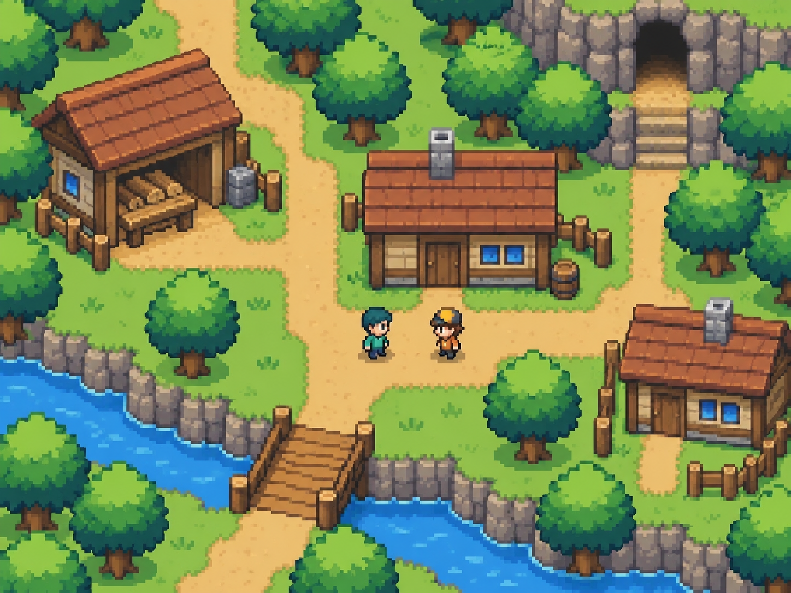

# Dirección visual, arte y animación

## Dirección acordada

Pixel art sencillo y legible, vista superior oblicua, personajes pequeños y escenarios que permiten navegar en ambos ejes. Tejados, fachadas, caminos, vegetación y entradas deben entenderse rápidamente. Reducir textura ornamental y sombras complejas respecto de los primeros conceptos demasiado detallados.

La imagen es una referencia conceptual generada, no una captura implementada. Sus caminos ilustran la intención, pero el mapa jugable debe diseñarse y comprobarse por separado. No convertir toda la imagen en un fondo con colisiones improvisadas.

## Qué requiere arte y qué requiere código

| Arte | Código y datos |
|---|---|
| Tiles de suelo, bordes, agua y edificios | Composición del mapa, colisiones, navegación y cambios |
| Cuerpo, pelo, ropa y equipo del PJ | Personalización, capas, orientación y guardado |
| Animaciones de acciones y enemigos | Estados, tiempos, impactos y cancelaciones |
| Iconos, retratos, efectos y UI | Interacción, inventarios, diálogos y accesibilidad |

La generación de imágenes puede ayudar a explorar diseños. Un conjunto jugable requiere recorte, alineación, transparencia, coherencia entre cuadros y revisión manual. La imagen de referencia no sustituye ese trabajo.

## Especificación técnica propuesta, modificable

Probar una cuadrícula base de 16 × 16 píxeles y personajes de 16 × 24 o 16 × 32 antes de producir todo el catálogo. Elegir una sola escala tras comprobar proporciones, equipo y legibilidad. No mezclar estas propuestas con los 24 píxeles por celda del prototipo lateral.

Usar filtrado nearest y escalado entero cuando sea posible. Mantener anclaje en los pies. La colisión representa la parte que ocupa suelo y no toda la altura del dibujo. Ordenar por profundidad desde los pies; separar copas y tejados cuando el PJ pase detrás o debajo. Definir reglas de ocultación para interiores.

## Personaje y animaciones

Preparar y validar primero una muestra de cuerpo, pelo y ropa combinables en cuatro orientaciones. Alinear todos los cuadros y las capas con el mismo origen. Evitar que accesorios desaparezcan o cambien de lado accidentalmente.

Estados necesarios a medida que se implementan sus acciones: reposo, caminar, usar herramienta, atacar, recibir daño y caer o quedar incapacitado. Las cuatro direcciones deben ser coherentes. La cantidad de cuadros y la duración se deciden con una prueba en motor; no están verificadas ni fijadas por un donante. No producir un catálogo de combate antes de decidir su modelo.

## Mapa y objetos

Suelo con variaciones limitadas; transiciones entre materiales; agua y orillas; vegetación; objetos recolectables con estados; piezas de construcción; entradas legibles; cofres cerrados/abiertos; indicadores de interacción. Los objetos que se rompen o construyen requieren variantes de estado, no solo una ilustración estática.

Definir paleta, escala, luz y contorno en una hoja de estilo. Identificar zonas transitables sin depender exclusivamente del color. Las señales de ataques necesitan suficiente contraste sobre el escenario.

## Registro de recursos

Cada recurso lleva ID, autor, origen, licencia, modificaciones, escala, tamaño, pivote, estados y ubicación. Distinguir provisional y final. No reutilizar sprites, edificios o mapas de Pokémon ni recursos propietarios de Helbreath. Conservar atribuciones y condiciones por archivo para cualquier recurso externo.
